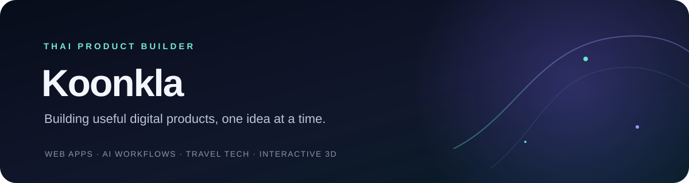
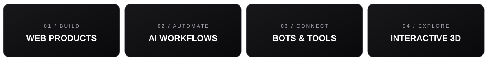
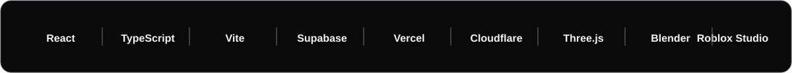

<div align="center">




</div>

---

### WHAT I DO



### ABOUT ME

ผมชอบสร้างเว็บแอป บอต และประสบการณ์ดิจิทัล ตั้งแต่เริ่มจากไอเดีย ทำต้นแบบ แล้วปรับต่อจนใช้งานได้จริง

- **Web products** — เว็บแอปและเครื่องมือที่ช่วยแก้ปัญหา
- **AI and automation** — ผู้ช่วยอัจฉริยะ บอต และ workflow
- **Interactive 3D** — ประสบการณ์และต้นแบบสำหรับเกม

### TOOLKIT



### HOW I BUILD

```text
IDEA  →  PROTOTYPE  →  FEEDBACK  →  IMPROVE
```

<div align="center">

BUILD WITH CURIOSITY · KEEP MAKING IT BETTER

</div>
